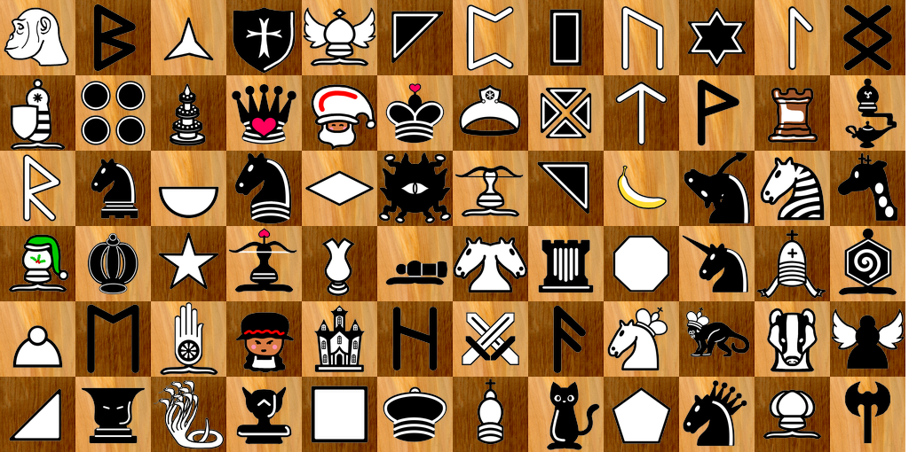
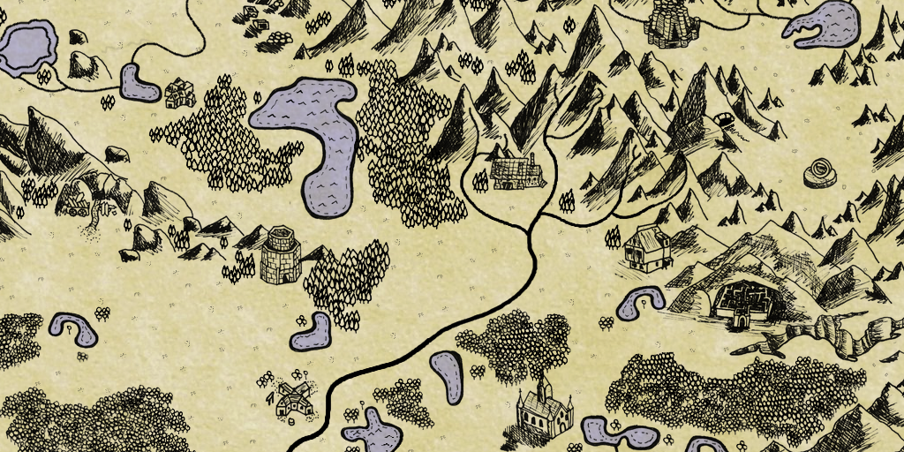

# ChessCraft Creative Commons

Here you can find all the art assets used in [ChessCraft](http://www.chesscraft.ca) shared under a creative commons license. You can [download the whole repository here](https://gitlab.com/zulban/chesscraft-creative-commons/-/archive/master/chesscraft-creative-commons-master.zip). If you find art or sounds or music in ChessCraft that isn't here, let me know and I'll add it.

Enjoy!

# Pieces

Browse over 200 chess-like pieces [in this folder](https://gitlab.com/zulban/chesscraft-creative-commons/tree/master/assets/Resources/Pieces). Most of these were hand drawn in GIMP by me.

# Sounds

Browse around 100 fantasy item and equipment sounds [in this folder](https://gitlab.com/zulban/chesscraft-creative-commons/tree/master/assets/Sounds/items). The item sounds were recorded by clanging around regular household items and bobbles, which was a lot of fun.

# Adventure Map

Browse the [adventure map folder](https://gitlab.com/zulban/chesscraft-creative-commons/tree/master/assets/Sprites/adventure) to see adventure maps, and the many tiny images used to build them in the [doodad palette](https://gitlab.com/zulban/chesscraft-creative-commons/tree/master/assets/Sprites/adventure/doodad-palette). Much of these were hand drawn on paper by me, and assembled and tweaked in GIMP.

# License

All files in this repository are shared under the [Attribution-ShareAlike 4.0 International](https://creativecommons.org/licenses/by-sa/4.0/) license.

# Attribution

Some assets require additional atrtibution.

### Music

The music in game is shortened to save space. The `assets/Music` folder here has the full songs. The artists:

* [One Man Symphony](https://onemansymphony.bandcamp.com/releases)
* `Politique 2.0`
* [Meydan](https://meydan.bandcamp.com/)
* Persia. This is the name of my cat. Twice she has jumped on our electronic piano, hit record, and played a tune. She is the honest to goodness composer and pianist of the "draw" and "loss" musical tunes.

In each case, I asked the artist if we can release their music under the same license. They all agreed, except my cat, who did not respond.

### Emoji

The emoji are from [openmoji](https://openmoji.org/) and share the same license.

### Champions and Items

Generative AI was used (OpenAI and Google) for the champion images and item images with many tweaks by me and a GIMP effect that helps a lot with visual consistency. So while I release the results of my prompts, tweaks, and GIMP effects under the same license, I leave it to you to consider further copyright, licensing, and ethical considerations in your project.

### Wikimedia

Some pieces were copied from the Wikimedia Commons [SVG chess pieces](https://commons.wikimedia.org/wiki/Category:SVG_chess_pieces), sharing the same license:

* classic chess pieces
* commoner
* boat
* zebra
* giraffe
* archbishop
* chancellor
